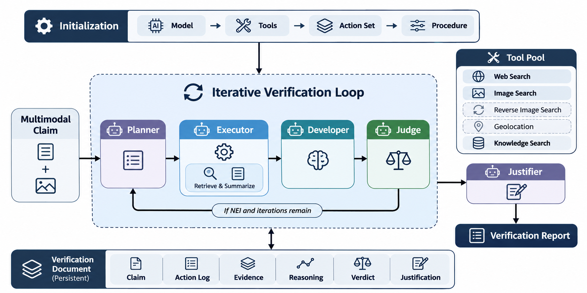

# Project Background

The rapid growth of the internet and social media has changed how news is published and shared. Alongside traditional news websites, news now circulates through short video platforms, social networks, and online communities. Combining text and images makes stories more vivid, while reposting, commenting, and editing allow information to reach large audiences quickly.

The widespread use of text and images makes factual verification more complex. A report may describe fabricated events, cite incorrect data, or misstate when and where an event took place. Authentic images can also be taken out of context and paired with reports about a different time, location, or event. Even when text and images appear plausible and consistent with each other, that consistency does not establish that the reported event actually occurred. Content features and text-image alignment alone therefore provide insufficient grounds for factual verification.

Retrieving external information can support fact-checking, but search results may have unclear origins, repeat the same source, contain errors, or fail to address the specific claim. Several websites reproducing one original report do not constitute independent evidence, and similar reports or images may refer to different events. Limited evidence, conflicting sources, or missing records make definitive judgments prone to error.

Against this background, the project aims to build a Multimodal News Fact-Checking and Evidence Reliability Enhancement System that bases its judgments on reliable, traceable external evidence. The proposed system would assess source reliability, factual relevance, source independence, and evidence sufficiency to establish a clear link between news claims and verification conclusions. When evidence is insufficient, it should preserve uncertainty and provide sources and reasoning so that users can understand, trace, and review the results.

# System Framework

The first version is organised as a modular, iterative pipeline. Rather than judging a claim in a single pass, the system alternates between *gathering* and *re-assessing*: each round it plans what information is still missing, retrieves that information, reasons over what is now known, and decides whether a verdict can already be justified. Everything learned along the way is accumulated in one persistent verification document, so any conclusion can later be traced back to the evidence it was based on.

## Architecture at a glance



## Core components

| Component | Responsibility | Module |
|---|---|---|
| Orchestrator | Wires all components together and exposes the entry points | `fact_checker.py` |
| Planner | Decides which actions the next round should perform, and why | `planner.py` |
| Executor | Routes actions to the matching tools, then collects results and summaries | `actor.py`, `tool.py` |
| Developer | Reasons over the current state and identifies what is still missing | `procedure.py` |
| Judge | Turns the verification document into a single verdict label | `judge.py` |
| Justifier | Condenses the whole document into a human-readable justification | `doc_summarizer.py` |
| Verification document | Persistent record held across rounds: claim, actions, evidence, reasoning, verdict, justification | `report.py` |

## The iterative loop

```text
verdict = "not enough information"
round   = 0
while verdict == "not enough information" and round < max_rounds:
    round += 1
    actions, reasoning = Planner(doc)           # what is still missing?
    if actions:
        doc.add_actions(actions)
        evidence = Executor(actions, doc)       # retrieve, then summarize
        doc.add_evidence(evidence)
        Developer(doc)                          # what does this tell us?
    verdict = Judge(doc, final=(round == max_rounds or not actions))

Justifier(doc) → Verification Report
```

Two properties matter when planning further work:

- **Cost is multiplicative.** One search action triggers one summary per retrieved source plus one aggregation step, and the loop multiplies that by the number of rounds. The three knobs that control it — maximum rounds, results per action, maximum result length — are configuration rather than code.
- **Tools define the ceiling of what the model may do.** The available action set is the intersection of *what the installed tools offer* and *what the configuration allows*. A tool that is not installed cannot be used, even if the model asks for it.
